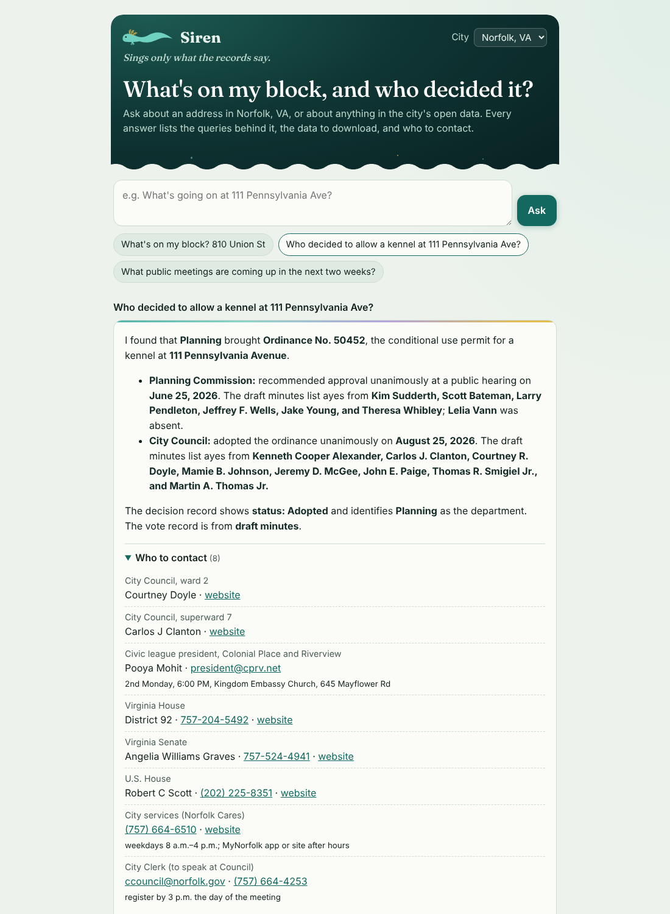

# socrata-agent

Ask your city's open data two questions: **what's on my block, and who decided it?**

It reads a city's Socrata open data portal and its public meeting records, and
answers in plain language. Every answer comes with:

- **the trace**: every query it ran, in order, with row counts and a link to rerun it,
- **the data**: each dataset it touched, as a dataset page, the exact rows it
  used as CSV, the API docs, and a full CSV download where the dataset holds no
  withheld columns or rows,
- **the people**: your council members, civic league, state and federal
  representatives, and the city's service line.

When the agent reaches the edge of what it can do, those links are where you
pick up.

## How it talks

The agent reports what its queries returned, never what is true on the ground.
It says **"I found 2 open work orders"**, never "there are 2 open work orders".
An empty result reads "I found no complaints for this parcel", because a query
that finds nothing is not proof that nothing exists.

Code enforces this, not the prompt alone. After each answer, a check looks for
"there is / there are / nobody / no one". If it finds any, the model rewrites
the answer once. If it still fails, the answer is flagged.

The trace is written by code as each request runs. The model never writes it, so
it can't make one up.

## Three ways to use it

### 1. The web app (for everyone)

A Cloudflare Worker serving a chat page. One shared model key, with limits per
visitor and per day. See [Deploy](#deploy-the-web-app).

### 2. The CLI (bring your own key)

```bash
export OPENROUTER_API_KEY=sk-or-...          # https://openrouter.ai/keys
npx -y github:jedelman/socrata-agent ask "What's on my block? 810 Union St"
npx -y github:jedelman/socrata-agent ask "How many pothole complaints did Chicago get in the last 30 days?" --city chicago
```

Or clone it and run `node bin/socrata-agent.js ask "..."`. Add `--json` for
machine-readable output, or `--model anthropic/claude-sonnet-5.5` for a stronger
model. With a `claude-*` model, `--thinking` prints the model's summarized
thinking to stderr as it comes.

`tool` runs a single tool with no model and no key, and prints the result, the
trace and the resources as JSON:

```bash
node bin/socrata-agent.js tool block_report '{"address":"111 Pennsylvania Ave"}'
node bin/socrata-agent.js tool get_legislation '{"legislation_id":"5832"}'
node bin/socrata-agent.js tools --city norfolk     # list tools
```

### 3. The Claude Code skill

Open this repo in Claude Code and the skill in `.claude/skills/socrata-agent/`
loads automatically: Claude becomes the agent, drives `socrata-agent tool`, and
follows the same contract. To use it in other projects, copy that folder to
`~/.claude/skills/`. It calls the CLI through `npx`, so no clone is needed.

## Cities

| City | Portal | What works |
|---|---|---|
| Norfolk, VA | data.norfolk.gov | Everything: block report, contacts, legislation and roll-call votes, upcoming meetings, any dataset |
| Seattle, WA | data.seattle.gov (API at cos-data.seattle.gov) | Search, describe and query any dataset, with download links |
| Chicago, IL | data.cityofchicago.org | Search, describe and query any dataset, with download links |
| Any other Socrata city | `--city data.example.gov` | Same as Seattle and Chicago |

Adding the block report and "who decided" for another city means writing a
city profile, not code. See [docs/adding-a-city.md](docs/adding-a-city.md).

## What it covers in Norfolk, and what it doesn't

**Block report** (`block_report`), all checked against the live portal:

- The address resolves through *Address Information* (`ere7-kake`) to a parcel id
  (GPIN), ward and superward, civic league, precinct, schools, trash day, and
  every representative with their contact details.
- Matched by parcel: Permits, Plan Reviews, Complaints, Violations, Code
  Enforcement Cases, Inspections.
- Matched by street: Work Orders, on the same street in the same ward. This
  dataset has no house numbers, so "your street" is as close as it gets. Open
  work orders are fetched on their own, so an old open order isn't buried under
  recent closed ones.
- Matched by hundred block: right-of-way permits and closures.
- Agenda items that name the address or another address on its hundred block.

**Who decided it** (`get_legislation`) reads the city's iqm2 record for each
item: status, the department that brought it, and every body that voted, with
the result and names for ayes, nays, abstentions and absences. Records from
draft minutes are flagged.

**Known limits:**

- The legislation index (`data/norfolk-legislation.json`) covers agenda items
  with a legislative record from meetings listed in the Public Meeting Notices
  dataset. That dataset starts in July 2023, and in practice the index holds
  City Council and Planning Commission items. Board of Zoning Appeals and
  Architectural Review Board agendas don't publish linked records, so they
  aren't matched yet.
- Agenda items are matched by the street address written in their title.
  Citywide ordinances, budgets, and items that name only a business won't match
  an address. `find_legislation` searches titles by keyword.
- Decisions made inside a department (a permit issued, a complaint closed) are
  not votes. The agent names the department on the record, which is not always
  the person who decided.
- *Plan Reviews* contains test rows (for example "1234 Gwaltney Way", GPIN
  `12345678`).
- Police warrants and arrest reports are **excluded**, as is any dataset whose
  name suggests records searchable by personal name. The agent will not look
  people up.

## Make it your group's own

A campaign or nonprofit can run its own copy with its own tools, focus and model
budget, then send what works back upstream. Two pieces:

- **A deployment config** in `deployments/` adds plugins, contacts, links,
  exclusions and focus notes. It can't remove exclusions or switch off the
  trace or the voice check. For Claude models it can also turn on web search,
  limited to the sites it lists (see [Web search](#web-search)).
- **Plugin tools** in `plugins/` get a traced context and never a raw `fetch`.
  `test/conformance.js` checks them before they are merged.

The worked example is a Norfolk sponge-city deployment. Its plugin,
`water_on_my_block`, returns, for any address:

- the FEMA flood zone at the parcel and the evacuation zone;
- flood insurance claims in the census tract, by cause (rain versus tide);
- stormwater inspections and work orders in the civic league;
- tree removals versus plantings;
- the nearest tide gauge that is still reporting.

```bash
node bin/socrata-agent.js ask "Does my block flood?" --config deployments/sponge-city-norfolk.config.js
```

The deployment also carries a city-wide **sponge-city screen**: where rain
gardens, bioswales and trees would do the most good. It ranks city-owned vacant
lots by recorded flooding, rain-caused flood claims, tree loss and income, then
checks the top candidates on five things: flood zone, storm surge, soils, nearby
drains, and existing stormwater projects. Bioswale candidates are ranked by
street. Read the [report](docs/sponge-screen-norfolk.md); rebuild it with
`node scripts/build-sponge-screen.js` (about 680 traced queries). The
`sponge_site_screen` plugin serves the results to the agent.

For groups, the web app can sit behind Cloudflare Access, which counts limits
per verified person. The Worker checks the signed token; it never trusts the
email header. See [docs/extending.md](docs/extending.md) and
[CONTRIBUTING.md](CONTRIBUTING.md).

## Siren



The public deployment is **Siren**, at
[ask-siren.jason-edelman.org](https://ask-siren.jason-edelman.org/). The name
does three jobs: Norfolk is the Mermaid City; the greater siren is a salamander
of Virginia's coastal-plain swamps; and a siren is an alarm. Its config is
`deployments/siren.config.js`, `[env.siren]` in `wrangler.toml` puts it on its
own hostname as a Workers Custom Domain (deploying creates the DNS record and
the certificate), and `ui` gives it its own skin (`worker/skins.js`):
blackwater greens, spatterdock gold, a greater-siren mark, and the tagline
*Sings only what the records say*. Other deployments keep the plain page.

Until 2026-11-10 Siren lived at `jason-edelman.org/ask-siren`. Its old routes
stay on the Worker, and `MOVED_FROM` makes that address answer only with
redirects to the same path and query on the new host, minus `/ask-siren`
(301 for GET and HEAD, 308 for the rest; `worker/moved.js`), over http or
https. Plain http on the new host goes to https. A deployment served under a
path on someone else's site sets `BASE_PATH` instead; Siren's is empty.

What the move does to people (2026-11-10):

- **Email sign-ins end.** The account cookie belonged to jason-edelman.org.
  Signing in again on the new host finds the account's invite and
  conversations as they were (both are kept by account, not by host).
- **An invite held only as a cookie comes along.** Someone who entered a
  code without signing in by email has it only as a cookie on the old host,
  and entering the code again would spend another use (a single-use code
  has none left). So a visit to the old address with that cookie goes
  through `<new>/carry-invite`, with a token signed with `INVITE_SECRET` and
  good for two minutes, which sets the invite on the new host, spends no
  use, and opens the page asked for. A browser that already holds an invite
  on the new host keeps its own.
- **Tabs left open across the deploy must be reloaded.** A page loaded from
  the old address still posts to it, and those requests now meet a
  redirect to another origin, which they can't follow; reloading lands on
  the new host.
- The cookies are now `__Host-siren_user` and `__Host-siren_invite`:
  host-only, `Path=/`, `Secure`, so no other host or subdomain can set or
  shadow them. (Under a `BASE_PATH` they keep their plain names, since a
  `__Host-` cookie must have `Path=/`.)
- **Two scheduled tasks read the feed by its old URL** and need their stored
  prompts updated after the deploy: "Siren: sync source requests to issues"
  (`docs/request-sync-routine.md`) and "Siren: fulfill a source request".
  Until then the old URL keeps working through the redirect.

Signed in with an invite, "Your conversations" on the chat page lists an
account's conversations newest first, 20 at a time with **Show more**, and
searches them: the questions and answers of the account's own 300 most
recently updated conversations (never the tool results behind them), up to
20 matches with a snippet each, opening the conversation at the matching
turn. The search text is sent in a POST body, never logged, stored or cached,
and each account may search 100 times a day.

The chat page, like the request pages, is served under a strict
Content-Security-Policy: no inline script or style (its script and style are
`worker/chat-page.js` and `worker/chat.css`, served under
`<base>/assets/<hash>/`), scripts only from Siren and the two pinned CDN
files, and fetches only to Siren.

```bash
npx wrangler kv namespace create LIMITS --env siren   # paste the id into [[env.siren.kv_namespaces]]
npx wrangler secret put OPENROUTER_API_KEY --env siren
npx wrangler secret put IP_SALT --env siren
npx wrangler deploy --env siren
```

The public request list (`https://ask-siren.jason-edelman.org/requests`) can be endorsed with a
Bluesky account. An endorsement is a public record in the endorser's own
repo, written by their browser with one narrow permission; Siren counts the
records through Constellation and lists who endorsed, with bots flagged. No
new dependency and no new secret; the Worker never sees a token. It needs
`PUBLIC_ORIGIN` (set in `[env.siren.vars]`), the three
`[[env.siren.ratelimits]]` bindings and `BLUESKY_LOGIN = "true"`, which stays
unset until the rollout's live probe passes. The record, the flow, the
counts, the flags and the rollout are in
[docs/bluesky-endorsements.md](docs/bluesky-endorsements.md).

**The free tier** (behind `PUBLIC_ASK`, off): ask in public with a Bluesky
sign-in and an invite, at `/questions`. Every question, answer and asker's
handle is public, on Siren's site only (a row in the `SIREN_DB` D1 database
and a page at `/q/<id>`), and anyone with an invite can ask a follow-up as a
threaded reply. The question is a record in the asker's own repo; Siren
reads it there, answers its text, and takes the page down when it's deleted:
within seconds, by a Durable Object that watches Jetstream for deletions in
the question collection and confirms each at the asker's PDS (binding
`QUESTION_WATCHER`; `JETSTREAM_URL` overrides the public instances), and in
any case within about an hour, by a Cron Trigger that re-checks public
questions every ten minutes (both no-ops while the flag is off).
Email sign-in stays the private tier. The design, what is stored, threads
and the rollout (publish the question Lexicon, apply migration 0004, then
set the flag) are in [docs/free-tier.md](docs/free-tier.md); the steward
hides a question at `/admin/questions` or with
`node scripts/invites.js question-hide <id>`.

## Web search

For Claude models, a deployment can let the agent search the web, but only
the sites it lists. It is off unless the config sets it:

```js
webSearch: { allowedDomains: ['law.lis.virginia.gov', 'msc.fema.gov', 'congress.gov/bill'], maxUses: 3 },
```

The list goes to Anthropic's web search tool as its `allowed_domains`, and
the API enforces it. Entries are bare domains (no `https://`), lowercase
ASCII, optionally with a path; subdomains are included, so `lis.virginia.gov`
covers `law.lis.virginia.gov`, and a subdomain entry covers only itself.
Because subdomains are included, list agencies, not whole government
domains: `virginia.gov` would also cover the State Police's Wanted and
Missing Persons pages (`vsp.virginia.gov`). And because the API takes an
allowlist or a blocklist, never both, a site with one section that names
private people (police news, hearing packets with owners' names, public
comments, wanted or debarment lists) is listed by subdomain or path, or not
at all: web search must not become the people-finding the dataset policy
refuses. Probe a site before listing it. The
config is checked at startup: wildcards in the domain, IP addresses, bare
TLDs, duplicates and entries another entry already covers are refused, and
so is any list that covers the city's open data portal (`norfolk.gov` covers
`data.norfolk.gov`; list the subdomains you want instead), because portal data goes
only through the dataset policy. `maxUses` (1 to 10) caps searches per step.
The prompt tells the model to use search only for official pages its other
tools can't reach, never to look up a person, a business's owner or an
address's residents, and to attribute what a page says to the page.

Anthropic runs each search, not the Worker. The trace gets a step per search,
written by code from the API's response (the query, how many results, the
result links, and that Anthropic ran it), and the pages the answer cites (or
every result, when it cites none) are listed under the answer as web pages,
not records. Each search costs $10 per 1,000 on top of tokens (Anthropic's
pricing page, 2026-11-10), and it counts toward `DAILY_BUDGET_USD`. When the
API pauses a long search turn (`pause_turn`), the agent sends the turn back
and continues; each continuation is a step and an outbound request like any
other model call, and the answer is the whole turn's text, from before the
pause and after it. Siren's list is in `deployments/siren.config.js`: the
Code of Virginia, state and federal bill pages, the Census Bureau, USGS,
FEMA's flood maps, NOAA's tides and sea-level sites, Virginia's
conservation and forestry departments, VDOT's project pages, and three paths
on the City's site: its Form Center, its newsletters and its Document Center
(PDF forms, alongside Planning staff reports that name land-use applicants;
Jason accepted that for the forms). The rest of the
City's site and the meeting portal are left off: City news shares one path
with police news, which names arrested and missing people, and hearing
packets list nearby owners; the config records what each probe found on
every site left off. City announcements reach Siren through the `city_news`
tool instead: it reads the City's News Flash and Alert Center RSS feeds by
category, and leaves Police and Commonwealth's Attorney news out in code (an
allowlist of categories, checked against each feed's own title; a check that
drops items cross-posted from those two feeds; and a check on crime and court
wording).
Web search must be enabled for the Anthropic organization (Console,
capabilities), and if the organization restricts domains there, the
deployment's list must sit inside that list; otherwise the API refuses the
request. `WEB_SEARCH = "off"` in the Worker's vars turns it off at once.

## Deploy the web app

```bash
npm install
npx wrangler kv namespace create LIMITS      # paste the id into wrangler.toml and uncomment the block
npx wrangler secret put OPENROUTER_API_KEY   # for OpenRouter models; a dedicated key with its own credit limit
npx wrangler secret put ANTHROPIC_API_KEY    # for claude-* models, e.g. MODEL=claude-haiku-5-5
npx wrangler secret put IP_SALT              # any random string
npx wrangler deploy
```

Limits, set in `wrangler.toml`:

| Setting | Default | What it does |
|---|---|---|
| `PER_IP_DAILY` | 20 | Questions per visitor per day. IPs are hashed with `IP_SALT` and never stored raw. |
| `DAILY_BUDGET_USD` | 2 | Model spend per day across all visitors: OpenRouter's reported cost, or for Claude models the response's token usage at Anthropic's list prices |
| `MAX_STEPS` / `MAX_TOKENS` | 6 / 1200 | Tool rounds and answer length per question |
| `MODEL` | `openai/gpt-5.6-luna` | The model everyone shares. Ids starting `claude-` (such as `claude-haiku-5-5`) go straight to Anthropic's API with `ANTHROPIC_API_KEY`; anything else goes through OpenRouter |
| `EFFORT` | model default | For Claude models: `low`, `medium`, `high`, `xhigh` or `max` |
| `MAX_TOKENS_CLAUDE` | 8000 | Output allowance per call for Claude models (1000–16000). Thinking counts toward it; a call cut off at the limit is retried once at 16000 and its tool calls are never run |
| `SUBREQUEST_BUDGET` | 120 | Outbound requests per answer (10–10000), counting every Socrata, meeting-portal and plugin request and every model call and retry. The answer stays within it: tool requests stop while enough is left for the final answer; the answer then says it stopped at the limit, and the trace marks the requests not sent as refused |
| `CITIES` | `norfolk,seattle,chicago` | Cities offered in the picker |
| `WORKING_NOTES` | on | The live working notes on the chat page (see below). `"off"` sends the plain answer only |
| `CONVERSATION_DAYS` | unset: kept until deleted | Signed-in accounts' private conversations are kept until the account deletes one or all of them. A number of days (1 to 365) expires them instead |
| `WEB_SEARCH` | on where the deployment sets `webSearch` | `"off"` drops web search from every answer (see [Web search](#web-search)); the Anthropic organization must allow web search in the Console, or requests carrying the tool fail |

Claude spend is priced from each response's token usage. The SDK retries a
failed call once (on rate limits, server errors and timeouts), only before a
response arrives; an attempt the API billed but never answered isn't in that
usage, so keep the workspace spend limit as the backstop. Calls are streamed,
and a stream that fails partway, or runs past five minutes, is stopped and not
retried: it is priced from what it had streamed (the input the API reported,
output estimated from the characters that arrived) and the question gets an
error. Spend is recorded per model call as each is priced, not once per answer.

While an answer is worked out, the chat page shows **working notes** under
the question: for Claude models, the model's own summary of its thinking as
it streams (thinking display "summarized"), and a code-written line for each
tool as it runs (a fixed label, never the model's arguments). The page labels
them as the model's summarized notes, not the answer and not checked like
answers, and folds them away when the answer arrives. The page asks for them
with `Accept: application/x-ndjson`; `POST /api/ask` then sends one JSON
object per line and ends with a `final` line carrying exactly the body it
returns without streaming (`worker/ask-stream.js` lists the line types).
Limits, spend and the conversation save are the same either way. A reader
who leaves mid-answer doesn't stop it at once: it runs under `waitUntil`,
which Cloudflare extends about 30 seconds past the moment they leave. Every
model call made by then is recorded in spend as it happens; the turn is saved
as soon as the answer exists (before the final line), so it is saved only if
the answer finishes within that grace period. If the connection drops, a
signed-in reader's page waits up to a minute for that save, showing the answer
if it arrives, before taking a new question in the same conversation (asking
at once would pay twice and race the save). The notes are live only: at most
20,000 characters of thinking per answer are sent, and none of it is saved,
traced, voice-checked or sent back to the model as text. Clients that don't
ask for the stream (the CLI, scripts) get the JSON answer as before.

An answer runs its whole tool loop in one Worker invocation, and Cloudflare
caps the external subrequests one invocation may make: 50 on Workers Free,
10,000 by default on Paid (checked 2026-11-06). Past that every fetch throws,
the model's included. `SUBREQUEST_BUDGET` keeps an answer within it: each
answer gets one counting fetch (`src/request-budget.js`) that every client on the
answer's path is built with. Tools are offered to the model only while that
model call (at its worst, retries included), one tool request and a reserve
all fit; tool requests are refused once only the reserve is left. The reserve
covers the final answer at its worst (a Claude call cut off at its token
allowance is asked once more, and each try can be retried) and one voice
rewrite call, which goes out only if it fits. Siren runs on Workers Paid
(since 2026-11-09), so the default 120 is a guard against a runaway answer,
not the platform cap. On Workers Free set it to 45, which leaves 5 under the
platform's 50 for the Access key fetch (twice when a key has rotated) and any
redirect hop, which Cloudflare counts but a fetch() call can't show. For scale, measured live
with `socrata-agent tool` on 2026-11-06: `block_report` makes 10 to 13
requests, `trees_on_my_block` 13 to 16, `water_on_my_block` 17, `case_file` 0,
`city_news` 8 (2026-11-10; at most 16 with a retry for every feed),
and each model step 1 (2 with a Claude retry); the `tool` command prints the
count as `outbound_requests`. The CLI's `ask` has no cap unless
`SUBREQUEST_BUDGET` is set in its environment (a whole number, 10 or more).

Without the KV binding the Worker refuses questions rather than run unlimited.
KV counts are eventually consistent, so a burst can overshoot by a few
requests: give the key its own hard ceiling too (an OpenRouter credit limit, or
an Anthropic Console workspace spend limit).

For local development, put `ALLOW_UNLIMITED=true` and your key in `.dev.vars`,
then run `npm run dev`.

## Cost

These are from `scripts/compare-models.js` on 2026-10-06: four questions per
model (an address report, a "who decided" question, an address that doesn't
exist, and a Chicago count). Raw output is in `eval/`.

| Model | Cost per answer | Notes |
|---|---|---|
| `openai/gpt-5.6-luna` (default) | $0.0002–0.003 | Accurate on all four; terse |
| `deepseek/deepseek-v4.1-flash` | $0.001–0.006 | Thorough, but repeats queries; needed one voice rewrite |
| `google/gemini-3.8-flash` | $0.009–0.024 | Good; needed one voice rewrite |
| `anthropic/claude-sonnet-5.5` | $0.02–0.065 | Most careful about what it didn't check; slowest |

At the default model, the $2 daily budget covers several hundred questions.

## Keeping Norfolk's index fresh

```bash
npm run build:norfolk     # about 5 minutes; rebuilds data/norfolk-legislation.json
```

A weekly GitHub Action does this and commits the result.

## Develop

```bash
npm test                   # offline: parsers, voice check, limits, a full agent turn against fakes
node scripts/compare-models.js openai/gpt-5.6-luna claude-haiku-5-5@low claude-sonnet-5-5
```

One runtime dependency, the official `@anthropic-ai/sdk` for Claude models. The
same `src/` runs in Node and in Cloudflare Workers.

## License

MIT
